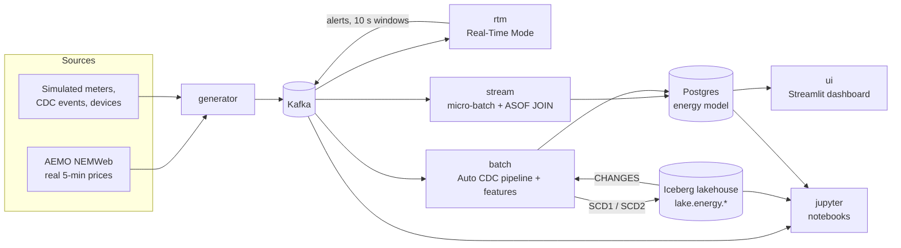

# Spark 4.2 / 4.3 Feature Lab

**A one-command local playground to quickly catch up on the latest Apache Spark features (4.2 and 4.3) using live, real-time data.**

## Why this repo exists

Apache Spark now ships a feature release every quarter. Spark 4.2 (mid-2026) and Spark 4.3 (October 2026) added a lot at once:
Auto CDC with SCD Type 1 and Type 2, ASOF JOIN, vector search in SQL, native geospatial types, Real-Time Mode for PySpark,
JSON_TABLE, VARIANT editing, metric views, nanosecond timestamps and more.

Reading release notes is not the same as seeing a feature run. Setting up Spark, Kafka, a database, a data feed and a UI just to try one
feature is slow, and you end up doing it again and again.

This repo removes that setup. **Clone it, run one command, and every feature runs on a live data stream on your laptop.**
Results land in a real dimensional model in Postgres and on a dashboard. Nothing to install except Docker, no cloud account, no API keys.

I built it to catch up on the new Spark features quickly, and I'm sharing it so anyone can do the same.

- Every feature listed below was **executed and checked against Spark 4.3.0**, not copied from docs.
- Where a feature does not work in open-source Spark yet, this README says so and explains the workaround used.
- The data is a realistic energy-retail scenario: **real Australian electricity market prices (AEMO)** plus simulated smart meters.

---

## Contents

1. [Quick start](#quick-start)
2. [Notebooks vs scripts: why both exist](#notebooks-vs-scripts-why-both-exist)
3. [Architecture](#architecture)
4. [Feature catalogue](#feature-catalogue)
5. [Measured results](#measured-results)
6. [How real-time is it?](#how-real-time-is-it)
7. [Data sources](#data-sources)
8. [Postgres data model](#postgres-data-model)
9. [Repository layout, folder by folder](#repository-layout-folder-by-folder)
10. [Configuration](#configuration)
11. [Everyday commands](#everyday-commands)
12. [Limitations found while testing](#limitations-found-while-testing)
13. [Troubleshooting](#troubleshooting)
14. [Versions](#versions)
15. [References](#references)
16. [License](#license)

---

## Quick start

### Prerequisites

- Docker Desktop (Windows / macOS) or Docker Engine + Compose v2 (Linux)
- About **8 GB RAM** given to Docker (12 GB is comfortable): four Spark JVMs run side by side
- About **6 GB disk** for images (the Spark image is ~3 GB)
- Internet access on first build (downloads images and Maven jars) and for live AEMO prices (optional)

### Run

```bash
git clone https://github.com/NaminduNadeeshan/spark-4.3-feature-lab.git spark-lab
cd spark-lab
docker compose up -d --build
```

The first build takes 5–10 minutes. After that, startup takes about a minute.

### Open

| What | URL / address |
|---|---|
| Dashboard (Streamlit) | http://localhost:8501 |
| JupyterLab (notebooks) | http://localhost:8888 → `notebooks/` |
| Spark UI of the notebook session | http://localhost:4040 (while a notebook is running) |
| Postgres | `localhost:5433`, database `energy`, user `lab`, password `lab`, schema `energy` |
| Kafka from your host | `localhost:9094` |

### What to expect in the first minutes

| Time after start | What you see |
|---|---|
| ~10 s | Generator backfills 24 h of meter intervals and 2 h of real AEMO prices into Kafka |
| ~30 s | Live tab of the dashboard starts filling: reads, cost, prices, Real-Time Mode windows |
| ~1 min | First alerts appear with their Real-Time Mode latency |
| ~2–3 min | First Auto CDC pipeline run finishes; **Meter explorer** and **Model & runs** tabs fill in |

### Stop / reset

```bash
docker compose down        # stop, keep data
docker compose down -v     # stop and delete all data (Kafka topics are recreated on next start)
```

No internet or nemweb.com.au blocked? Use synthetic prices:

```bash
PRICE_SOURCE=synthetic docker compose up -d
```

---

## Notebooks vs scripts: why both exist

The repo has **Python scripts** (`jobs/`, `pipelines/`) and **Jupyter notebooks** (`notebooks/`). They do different jobs.

### Scripts = the factory (always on)

The scripts are the **real pipeline**. Docker starts them and they run in the background without stopping, like production jobs would.

- They read the live Kafka streams all the time.
- They use the new Spark features to **build and keep updating the data model in Postgres**.
- The dashboard only reads what the scripts write.
- You do not run them by hand. `docker compose up` starts them, and they restart on failure.

**Use the scripts to see how the new features fit into a real, continuously running pipeline**: streaming, CDC dimension loads,
pricing joins, feature tables, KPIs.

### Notebooks = the lab bench (you drive)

The notebooks are for **learning and experimenting**, one feature at a time, step by step.

- You open them in JupyterLab and run cells one by one.
- Each section shows one feature: the code, the result, the query plan, and often the **old way vs the new way** with timings.
- They **only read** from Kafka and Postgres. They never write to the Postgres model, so you can change anything without breaking the pipeline.
- They include features that don't fit a production pipeline, such as UDF transpilation and nanosecond timestamps, and they show every `CHANGES` option side by side.
- The notebooks in this repo are committed **with their outputs**, so you can read the results on GitHub without running anything.

**Use the notebooks to understand a feature**: what the syntax is, what it returns, what the plan looks like, how fast it is, and where its limits are.

### Side by side

| | Scripts (`jobs/`, `pipelines/`) | Notebooks (`notebooks/`) |
|---|---|---|
| Role | Run the pipeline | Explain and test features |
| Started by | Docker, automatically | You, cell by cell |
| Runs | 24/7 in the background | On demand |
| Writes to Postgres | Yes, the whole model | No, read-only |
| Output | Tables the dashboard reads | Printed tables, plans, timings |
| Change safely? | Changes affect the dashboard | Experiment freely |
| Best for | "How would I use this in production?" | "What does this feature do?" |

The notebooks need the stack running, because they read the same Kafka topics and Postgres tables the scripts use.

---

## Architecture



| Container | Image | What it does |
|---|---|---|
| `kafka` | apache/kafka 4.1.0 (KRaft, single node) | Holds every live stream |
| `postgres` | postgres 17 | Final dimensional model |
| `generator` | Python 3.12 | Publishes prices, meter reads, intervals, CDC events, device JSON |
| `stream` | spark-lab (Spark 4.3.0) | `jobs/stream_to_postgres.py`: micro-batch into Postgres, ASOF-priced |
| `rtm` | spark-lab | `jobs/rtm_alerts.py`: Real-Time Mode alerts and stateful windows |
| `batch` | spark-lab | `jobs/batch_loop.sh`: incremental Auto CDC pipeline into Iceberg, then `jobs/batch_features.py`, every minute |
| `jupyter` | spark-lab | JupyterLab with the feature notebooks |
| `ui` | Python 3.12 + Streamlit | Dashboard on top of Postgres |

---

## Feature catalogue

Status key: ✅ works in open-source Spark 4.3.0 locally · ⚠️ works with a workaround · ❌ not usable locally yet

### Spark 4.2

| Feature | Before | Now | Status | Where |
|---|---|---|---|---|
| **Auto CDC, SCD Type 1** | Hand-written `MERGE` upserts | `dp.create_auto_cdc_flow(..., stored_as_scd_type=1)` in Declarative Pipelines | ✅ on Iceberg (nightly build), incremental | `pipelines/meter_cdc/transformations/meter_changes.py` |
| **CHANGES clause / `read.changes()`** | Snapshot diffs or Delta CDF | `SELECT * FROM t CHANGES FROM VERSION n [TO VERSION m] WITH ('computeUpdates' = 'true')`, plus carry-over removal and `netChanges` | ✅ on Iceberg through a small adapter, see limits | `jobs/batch_features.py` `dimension_changes`, notebook 01 §1 |
| **Vector functions** | Copy embeddings to a vector DB | `vector_cosine_similarity`, `vector_l2_distance`, `vector_inner_product`, `vector_norm`, `vector_normalize`, `vector_avg`, `vector_sum` | ✅ | `jobs/batch_features.py` `load_profiles`, notebook 01 §2 |
| **NEAREST BY top-K join** | Cross join + window rank | `JOIN ... EXACT\|APPROX NEAREST k BY DISTANCE\|SIMILARITY expr` and `df.nearestByJoin(...)` | ✅ brute force, no index yet | `jobs/batch_features.py`, notebook 01 §2–3 |
| **Geospatial types** | Apache Sedona or raw lat/lon maths | `GEOMETRY`, `GEOGRAPHY`, WKB I/O, SRIDs, Parquet | ✅ types and I/O only, no `st_distance` | `jobs/batch_features.py` `load_dimensions`, notebook 01 §3 |
| **Arrow Python UDFs by default** | Rewrite as pandas UDF or set Arrow configs | Plain `@udf` runs as `ArrowEvalPython` | ✅ | Notebook 01 §4 |
| **Real-Time Mode in PySpark** | Micro-batch seconds, or move to Flink | `.trigger(realTime="1 minute")`, about 10 ms latency | ✅ | `jobs/rtm_alerts.py`, notebook 01 §5 |
| **Metric views (governed metrics)** | Re-derive KPIs in every report | `CREATE VIEW ... WITH METRICS LANGUAGE YAML` + `MEASURE()` | ✅ | `jobs/batch_features.py` `region_kpis`, notebook 01 §6 |

### Spark 4.3

| Feature | Before | Now | Status | Where |
|---|---|---|---|---|
| **Auto CDC, SCD Type 2** | Expire old row, insert new, handle late and duplicate records by hand | `STORED AS SCD TYPE 2 TRACK HISTORY ON (...)`, rows bounded by `__START_AT` / `__END_AT` | ✅ on Iceberg (nightly build), incremental | `pipelines/meter_cdc/transformations/dim_meter_scd2.sql`, notebook 02 §1 |
| **ASOF JOIN** | Range join + `ROW_NUMBER()` | `LEFT ASOF JOIN p MATCH_CONDITION (r.ts >= p.ts) ON ...` (sort-merge operator) | ✅ off by default, enable `spark.sql.join.asofJoin.enabled` | `jobs/stream_to_postgres.py`, `jobs/batch_features.py`, notebook 02 §2 |
| **Python UDF → SQL transpilation** | Every UDF goes to Python | Simple UDFs become Catalyst expressions (`len()` → `length`) | ✅ experimental, see limits | Notebook 02 §3 |
| **JSON_TABLE** | `from_json` + `explode` chains | `LATERAL JSON_TABLE(doc, '$.items[*]' COLUMNS (...))` with `FOR ORDINALITY`, `EXISTS PATH` | ✅ no `NESTED PATH` yet | `jobs/batch_features.py` `device_diagnostics`, notebook 02 §4 |
| **VARIANT editing** | Parse, rebuild, re-serialise | `variant_set`, `variant_insert`, `variant_delete`, `variant_array_append`, `variant_strip_nulls` | ✅ | Same as above |
| **Stateful Real-Time Mode** | RTM was stateless only | `dropDuplicates` + windowed aggregation in RTM on pipelined shuffles | ✅ | `jobs/rtm_alerts.py`, notebook 02 §5 |
| **Nanosecond timestamps** (preview) | Microseconds max | `TIMESTAMP_NTZ(9)`, `timestamp_nanos`, `unix_nanos`, Parquet round trip | ✅ behind `spark.sql.timestampNanosTypes.enabled` | Notebook 02 §6 |
| Spark Connect REST endpoints, operation IDs | – | – | Not covered | – |

---

## Measured results

Measured on a 16-core Windows laptop (Docker Desktop, WSL2). Your numbers will differ. Rerun the notebooks to see your own.

| Test | Result |
|---|---|
| Real-Time Mode alert latency (read produced → alert produced) | **p50 ≈ 8–9 ms** (max spikes only while the query starts) |
| Stateful RTM windows | Each 10 s window updates and is re-emitted per record |
| ASOF JOIN vs range join + window, 540k reads × 150 prices | 2.08 s vs 2.27 s, **identical results**. The gain grows with the size of the right side. |
| Plan for ASOF JOIN | Dedicated `SortMergeAsOfJoin` operator |
| UDF transpilation, `len()` over 3M rows | **0.19 s transpiled** vs 0.79 s Arrow UDF (no Python in the plan) |
| Arrow-by-default UDF vs `useArrow=False`, 3M rows | 0.93 s vs 1.33 s |
| Auto CDC SCD2 with late, out-of-order events | Late events placed in history correctly, **never became current** |
| Auto CDC on Iceberg, second run | Only the new change events applied (Kafka checkpoint + persistent tables); each run is one Iceberg snapshot |
| `CHANGES` on the Iceberg SCD1 table | Raw rows include copy-on-write carry-overs; Spark's default removes them; `computeUpdates` emits `update_preimage`/`update_postimage`; `netChanges` collapses to one row per key |
| NEAREST BY on 24-dim load profiles | Nearest centroid always matched the meter's real segment |

---

## How real-time is it?

Not everything is real-time. Each part runs at the speed that fits its job:

| Part | Speed | Why |
|---|---|---|
| `rtm`: alerts and 10 s regional kWh | **Milliseconds** | Real-Time Mode, records flow straight through |
| `stream`: priced reads and per-minute usage in Postgres | **About 5–10 s** | Micro-batches. ASOF JOIN is not supported in Real-Time Mode. |
| `batch`: SCD1/SCD2 dimensions, change feed, similarity, substations, diagnostics, KPIs | **About 1–2 min** | Incremental pipeline run + feature job + 60 s pause |
| Dashboard | Refreshes every 5 s | Reads Postgres |
| AEMO prices | Every 5 min | That's how often the market publishes |

Alerts are detected in milliseconds but reach the dashboard in about 5–10 s, because the `stream` job moves them from Kafka into Postgres.

---

## Data sources

| Kafka topic | Producer | Content |
|---|---|---|
| `prices` | generator | **Real AEMO NEM 5-minute dispatch prices** (RRP, $/MWh) for NSW1, QLD1, VIC1, SA1, TAS1 from NEMWeb `DispatchIS_Reports`. Last 2 h backfilled, polled every 30 s. Falls back to synthetic prices if NEMWeb is unreachable. |
| `meter_reads` | generator | 40 simulated meters (residential, solar, EV, commercial) every 2 s. ~1% duplicate messages, injected voltage and power anomalies. |
| `meter_intervals` | generator | 24 h of 15-minute interval reads (NEM12 style) backfilled at startup |
| `meter_changes` | generator | CDC events every ~20 s: tariff changes, suspensions, new occupants, deletes, re-activations, and **late out-of-order events** |
| `device_events` | generator | Nested JSON device diagnostics (meter, comms, inverter, charger readings, fault flags, debug block) |
| `alerts` | `rtm` | Real-Time Mode alerts |
| `rtm_region_kwh` | `rtm` | Stateful Real-Time Mode 10 s windows |

AEMO data comes from the public NEMWeb site. Check AEMO's copyright terms before redistributing the data itself.

---

## Postgres data model

Schema `energy`. Connect with any SQL client to `localhost:5433` (`lab` / `lab`).

### Dimensions

| Table | Grain | Built by | Feature |
|---|---|---|---|
| `dim_region` | NEM region | `init.sql` seed | – |
| `dim_meter` | One row per live meter (SCD1) | Iceberg `lake.energy.dim_meter` → `batch_features.py` | Auto CDC SCD1, GEOGRAPHY WKB in `geog_wkb` |
| `dim_meter_history` | One row per meter version (SCD2) | Iceberg `lake.energy.dim_meter_history` → `batch_features.py` | Auto CDC SCD2 (`valid_from`, `valid_to`, `is_current`) |
| `dim_meter_change_log` | One row per change to the SCD1 table | `CHANGES FROM VERSION n EXCLUSIVE` on `lake.energy.dim_meter` | CHANGES clause with `computeUpdates` |
| `dim_substation` | Substation | `init.sql` seed | – |
| `bridge_meter_substation` | Meter × 2 nearest substations | `batch_features.py` | NEAREST BY + haversine |

### Facts

| Table | Grain | Built by | Feature |
|---|---|---|---|
| `fact_price_5min` | Region × 5-min interval | `stream` | – |
| `fact_meter_read` | Meter read (2 s) | `stream` | ASOF JOIN pricing, dedupe within watermark |
| `fact_usage_1m` | Meter × minute | `stream` | Incremental upsert |
| `fact_meter_interval` | Meter × 15-min interval | `batch` | LEFT ASOF JOIN (no price before the price history starts) |
| `fact_alert` | Alert | `rtm` → `stream` | Real-Time Mode, `latency_ms` |
| `fact_rtm_window` | Region × 10 s window | `rtm` → `stream` | Stateful Real-Time Mode |
| `fact_device_diagnostic` | Device event × reading | `batch` | VARIANT editing + JSON_TABLE |

### Features, KPIs, ops

| Table / view | Content | Feature |
|---|---|---|
| `meter_profile` | 24-dim normalised hourly load vector per meter | `vector_normalize` |
| `meter_similarity` | Top 3 most similar meters | NEAREST BY + `vector_cosine_similarity` |
| `kpi_region` | kWh, cost, avg price per region, last hour | Metric view + `MEASURE()` |
| `pipeline_run` | Every batch step with status and detail | – |
| `v_meter_current` | Meter + region + nearest substation | – |

### Try these queries

```sql
SELECT meter_id, tariff, status, customer, valid_from, valid_to, is_current
FROM dim_meter_history WHERE meter_id = 'MTR-0001' ORDER BY start_seq;

SELECT r.meter_id, r.read_ts, r.kwh, r.rrp, r.price_interval, r.cost_aud
FROM fact_meter_read r ORDER BY read_ts DESC LIMIT 20;

SELECT kind, count(*), percentile_cont(0.5) WITHIN GROUP (ORDER BY latency_ms) AS p50_ms
FROM fact_alert GROUP BY kind;

SELECT m.meter_id, m.segment, s.similar_meter_id, s.similarity
FROM meter_similarity s JOIN dim_meter m USING (meter_id) WHERE s.rank = 1;
```

---

## Repository layout, folder by folder

```
.
├── docker-compose.yml        all 8 containers
├── .env.example              optional settings (copy to .env)
├── docker/spark/             the Spark 4.3 image
├── generator/                live data producer
├── lib/                      shared helpers for scripts and notebooks
├── jobs/                     always-on Spark jobs (the factory)
├── pipelines/meter_cdc/      declarative Auto CDC pipeline
├── notebooks/                feature-by-feature walkthroughs (the lab bench)
├── postgres/                 database schema
└── ui/                       Streamlit dashboard
```

### `docker-compose.yml`
Defines and wires the 8 containers. `docker compose up -d --build` builds and starts everything.

### `docker/spark/`: the Spark image
One image is used by `stream`, `rtm`, `batch` and `jupyter`.

| File | Purpose |
|---|---|
| `Dockerfile` | `apache/spark:4.3.0` + JupyterLab, PySpark Connect deps, pandas/pyarrow, psycopg, the Kafka and Postgres JDBC jars, the Iceberg runtime, and the compiled changelog adapter |
| `resolve_jars.py` | Build-time helper that resolves Maven packages (Kafka connector, Postgres driver) and copies only the needed jars into Spark |
| `fetch_iceberg.sh` | Downloads the Iceberg Spark runtime: the pinned nightly snapshot, or the latest one if Apache has pruned it, or a Maven Central release when `ICEBERG_VERSION` is not a snapshot |
| `catalog/IcebergChangelogCatalog.java` | Extends Iceberg's `SparkCatalog` with Spark 4.2's `loadChangelog()`, so `CHANGES` works on Iceberg tables. Iceberg snapshot sequence numbers become `_commit_version`. Compiled during the build. |
| `spark-defaults.conf` | Every Spark session in the stack gets the `lake` Iceberg catalog (`/data/lakehouse`), ASOF JOIN enabled, and UTC |

### `generator/`: the data source
| File | Purpose |
|---|---|
| `app.py` | Creates Kafka topics and downloads AEMO prices. Simulates 40 meters with realistic daily load shapes per segment and publishes all five input topics. |
| `Dockerfile` | Small Python image for the generator |

### `lib/`: shared code
| File | Purpose |
|---|---|
| `lab.py` | Used by every script and notebook: Spark session builder (UTC, ASOF enabled), Kafka batch and stream readers, Postgres JDBC read, upsert/replace helpers, schemas, run logging |

### `jobs/`: the always-on scripts
| File | Container | Purpose |
|---|---|---|
| `stream_to_postgres.py` | `stream` | 4 streaming queries. Prices → `fact_price_5min`. Reads → dedupe → **ASOF JOIN** price → `fact_meter_read` + `fact_usage_1m`. Alerts → `fact_alert`. RTM windows → `fact_rtm_window`. |
| `rtm_alerts.py` | `rtm` | **Real-Time Mode**: stateless anomaly alerts (4.2) and stateful dedupe + 10 s windowed kWh per region (4.3), both to Kafka |
| `batch_loop.sh` | `batch` | Every `BATCH_INTERVAL_SEC`: runs the CDC pipeline incrementally with `spark-pipelines`, then `batch_features.py` |
| `batch_features.py` | `batch` | Loads SCD1/SCD2 from Iceberg into Postgres. Reads new changes with **CHANGES** into `dim_meter_change_log`. Builds **GEOGRAPHY** from WKB, nearest substations (**NEAREST BY**), ASOF-priced intervals, load-profile **vectors** and similarity, device diagnostics (**VARIANT edit + JSON_TABLE**), region KPIs (**metric view**). Every step is logged to `pipeline_run`. |

### `pipelines/meter_cdc/`: Declarative Pipeline
| File | Purpose |
|---|---|
| `spark-pipeline.yml` | Pipeline spec: name, checkpoint storage, settings |
| `transformations/meter_changes.py` | Kafka CDC source view + **Auto CDC SCD Type 1** (Python API) into Iceberg `lake.energy.dim_meter` |
| `transformations/dim_meter_scd2.sql` | **Auto CDC SCD Type 2** (SQL API) with `TRACK HISTORY ON` into Iceberg `lake.energy.dim_meter_history` |

### `notebooks/`: the walkthroughs
| File | Sections |
|---|---|
| `01_spark_4_2_features.ipynb` | 1 CDC and the CHANGES clause · 2 Vector search + NEAREST BY · 3 Geospatial types · 4 Arrow UDFs by default · 5 Real-Time Mode (stateless) · 6 Metric views |
| `02_spark_4_3_features.ipynb` | 1 SCD Type 2 Auto CDC · 2 ASOF JOIN vs the old way · 3 UDF transpilation · 4 JSON_TABLE + VARIANT editing · 5 Stateful Real-Time Mode · 6 Nanosecond timestamps |

### `postgres/`
| File | Purpose |
|---|---|
| `init.sql` | Creates schema `energy` and all tables, indexes and views. Seeds regions and substations. Runs once, on the first start of an empty volume. |

### `ui/`: dashboard
| File | Purpose |
|---|---|
| `app.py` | Streamlit app. **Live** (auto-refresh 5 s): KPIs, AEMO prices, RTM windows, ASOF-priced cost, alerts with latency. **Meter explorer**: SCD2 history, nearest substation, similar meters with load profiles, device diagnostics, interval reads, map. **Model & runs**: metric-view KPIs, row counts, batch run log. |
| `Dockerfile` | Python image with Streamlit, psycopg, pandas, Altair |

---

## Configuration

Copy `.env.example` to `.env` and change what you need. Docker Compose reads `.env` automatically.

| Variable | Default | Meaning |
|---|---|---|
| `PRICE_SOURCE` | `aemo` | `aemo` = real NEMWeb prices, `synthetic` = generated |
| `METERS` | `40` | Number of simulated meters |
| `READ_INTERVAL_SEC` | `2` | Seconds between meter reads |
| `BATCH_INTERVAL_SEC` | `60` | Pause between batch pipeline runs |
| `UI_PORT` | `8501` | Dashboard port |
| `JUPYTER_PORT` | `8888` | JupyterLab port |
| `SPARK_UI_PORT` | `4040` | Spark UI of the notebook session |
| `PG_PORT` | `5433` | Postgres host port (5433 avoids clashing with a local Postgres) |
| `KAFKA_PORT` | `9094` | Kafka host port |

---

## Everyday commands

```bash
docker compose ps
docker compose logs -f stream
docker compose logs -f rtm
docker compose logs -f batch
docker compose logs -f generator
```

Open a SQL shell on the model:

```bash
docker compose exec postgres psql -U lab -d energy
```

Watch a Kafka topic:

```bash
docker compose exec kafka /opt/kafka/bin/kafka-console-consumer.sh --bootstrap-server localhost:9092 --topic alerts
```

Run the CDC pipeline once by hand:

```bash
docker compose exec batch spark-pipelines run --spec /work/pipelines/meter_cdc/spark-pipeline.yml
```

Query the Iceberg tables and their change feed from SQL:

```bash
docker compose exec jupyter spark-sql -e "SELECT _change_type, meter_id, tariff, status FROM lake.energy.dim_meter CHANGES FROM VERSION 1 WITH ('computeUpdates' = 'true') LIMIT 20"
```

Re-execute a notebook headlessly (updates its saved outputs):

```bash
docker compose exec jupyter jupyter nbconvert --to notebook --execute --inplace /work/notebooks/02_spark_4_3_features.ipynb
```

After editing a script in `jobs/` or `lib/`, restart its container (the code is mounted, so no rebuild is needed):

```bash
docker compose restart stream rtm batch
```

---

## Limitations found while testing

These are real behaviours of open-source Spark 4.3.0 found while building this lab:

1. **Auto CDC needs a DSv2 catalog with row-level operations (MERGE).**
   - Delta 4.4.1 tables are rejected with `AUTOCDC_TARGET_DOES_NOT_SUPPORT_MERGE`, and so is the default Parquet catalog.
   - Apache Iceberg works, but there's **no released Iceberg build for Spark 4.2 or 4.3 yet**. The image uses the Apache nightly `iceberg-spark-runtime-4.2_2.13:1.13.0-SNAPSHOT` (built for 4.2, tested here on 4.3).
   - The pinned snapshot is `ICEBERG_SNAPSHOT_STAMP` in `docker/spark/Dockerfile`. Apache prunes old nightly builds, so `fetch_iceberg.sh` falls back to the latest one. A newer nightly could in theory break compatibility.
   - Once Iceberg releases a runtime for Spark 4.3, build with `--build-arg ICEBERG_SPARK=4.3 --build-arg ICEBERG_VERSION=<release>` to use Maven Central instead.
2. **CHANGES clause / `read.changes()`** only works on catalogs implementing `TableCatalog.loadChangelog()`. On the session catalog it raises `UNSUPPORTED_FEATURE.CHANGE_DATA_CAPTURE`, and Iceberg doesn't implement the hook yet either (it has its own `<table>.changes` view).
   - `lab.IcebergChangelogCatalog` bridges the two. It maps the requested version or timestamp range to Iceberg snapshots and reads them with Iceberg's own changelog scan. It also renames the metadata columns to Spark's contract: `_change_type`, `_commit_version` (= Iceberg sequence number) and `_commit_timestamp`.
   - The row identity comes from the table property `changelog.row-id` (set to `meter_id` on `lake.energy.dim_meter`), or from Iceberg identifier fields.
   - Spark also needs a *row version* to tell copy-on-write carry-overs from real updates. Iceberg v3 row lineage would be the natural source, but Iceberg's changelog scan doesn't expose it yet. The adapter therefore emits `_row_content_hash`: same content means a carry-over, changed content means an update.
   - Only batch reads are supported, not `readStream.changes()`. Timestamp bounds must be literals: `CHANGES FROM TIMESTAMP current_timestamp() - INTERVAL 1 HOUR` fails in the Spark 4.3 parser.
3. **Declarative Pipelines + the default session catalog**: a second run fails with `LOCATION_ALREADY_EXISTS` for materialised views, because there's no persistent metastore. This lab avoids it by writing the pipeline outputs to Iceberg, whose Hadoop catalog persists on disk.
4. **Geospatial**: OSS 4.3 has the types, `st_geomfromwkb`, `st_geogfromwkb`, `st_asbinary`, `st_srid` and `st_setsrid`. There is **no `st_distance`, `st_geomfromtext` or `st_point`**. Points are built as WKB with a small UDF, and distances use haversine.
5. **ASOF JOIN** is off by default (`spark.sql.join.asofJoin.enabled=true`, set in `lib/lab.py`). It's not supported in Real-Time Mode, and in micro-batch only stream-static joins work.
6. **UDF transpilation** only happens when all of these are true: `spark.sql.experimental.optimizer.transpilePyUDFs=true`, ANSI mode on, the UDF is **not Arrow** (`useArrow=False`), and lambdas are bound to a name on their own line. Since 4.2 made Arrow the default, plain `@udf` is **not** transpiled. Division (`wh / 1000`) was not transpiled in testing; `len()` was.
7. **Real-Time Mode** needs a free task slot for every stage of the pipelined group at once. Otherwise it fails with `CONCURRENT_SCHEDULER_INSUFFICIENT_SLOT`. The `rtm` container uses `local[12]` and 2 shuffle partitions. Changing shuffle partitions for a stateful query requires deleting its checkpoint.
8. **Metric views** need a catalog table as `source`. With no persistent metastore, the jobs register an external Parquet table each run.
9. **JSON_TABLE** has no `NESTED PATH` yet. `EXISTS PATH` means "the field exists", not "the value is true".
10. **NEAREST BY** is brute force (cross product), even in `APPROX` mode. Pre-filter the right side when it's large.

---

## Troubleshooting

| Problem | Fix |
|---|---|
| `Bind for 0.0.0.0:5433 failed: port is already allocated` (or 8501, 8888, 9094) | Set another port in `.env`, e.g. `PG_PORT=5434` |
| Containers restart or get OOM-killed | Give Docker more memory (8 GB minimum, 12 GB recommended) |
| Dashboard says "Waiting for the first Auto CDC pipeline run" | Wait 2–3 minutes, then check `docker compose logs batch` |
| No prices / `AEMO unavailable` in generator logs | NEMWeb is unreachable from your network. Set `PRICE_SOURCE=synthetic`. |
| `CONCURRENT_SCHEDULER_INSUFFICIENT_SLOT` in `rtm` | Machine or Docker has too few CPUs. Lower the cores in `jobs/rtm_alerts.py` only together with the shuffle partitions, then `docker compose down -v` to clear checkpoints. |
| Stream fails after you changed a query | Checkpoints are in the `spark-data` volume. Reset with `docker compose down -v`. |
| Build fails downloading Iceberg | The Apache snapshot repository was unreachable, or no 1.13.0 snapshot is published any more. Check https://repository.apache.org/content/repositories/snapshots/org/apache/iceberg/ and set `ICEBERG_VERSION` / `ICEBERG_SNAPSHOT_STAMP` build args. |
| `CHANGES` fails after a newer Iceberg nightly was pulled | Pin a known-good snapshot with `--build-arg ICEBERG_SNAPSHOT_STAMP=...` |
| Line-ending errors in `batch_loop.sh` on Windows clones | `.gitattributes` forces LF. If you cloned before it existed, run `git add --renormalize .` |
| Apple Silicon | The images are multi-arch. If a build fails, try `DOCKER_DEFAULT_PLATFORM=linux/amd64 docker compose up -d --build`. |

---

## Versions

| Component | Version |
|---|---|
| Apache Spark | 4.3.0 (`apache/spark:4.3.0`, Scala 2.13, Java 21, Python 3.10) |
| Kafka connector | `spark-sql-kafka-0-10_2.13:4.3.0` |
| Apache Iceberg | `iceberg-spark-runtime-4.2_2.13:1.13.0-SNAPSHOT` (nightly `1.13.0-20261106.001914-50`) |
| Kafka | `apache/kafka:4.1.0` (KRaft) |
| Postgres | 17, JDBC driver 42.7.7 |
| JupyterLab | 4.4 |
| Streamlit | 1.50 |

---

## References

- [Spark 4.3.0 release notes](https://spark.apache.org/releases/spark-release-4-3-0.html)
- [Spark 4.2.0 release notes](https://spark.apache.org/releases/spark-release-4-2-0.html)
- [ASOF JOIN syntax](https://spark.apache.org/docs/4.3.0/sql-ref-syntax-qry-select-asof-join.html)
- [JSON_TABLE syntax](https://spark.apache.org/docs/4.3.0/sql-ref-syntax-qry-select-json-table.html)
- [Declarative Pipelines programming guide](https://spark.apache.org/docs/4.3.0/declarative-pipelines-programming-guide.html)
- [AEMO NEMWeb current reports](https://nemweb.com.au/Reports/Current/)

---

## License

The code in this repository is released under the [MIT License](LICENSE).

Third-party software (Apache Spark, Apache Iceberg, Apache Kafka, PostgreSQL, Streamlit and others) is downloaded at build time under its own license and is not redistributed here.
Price data is fetched live from AEMO's NEMWeb and is subject to AEMO's copyright terms.
